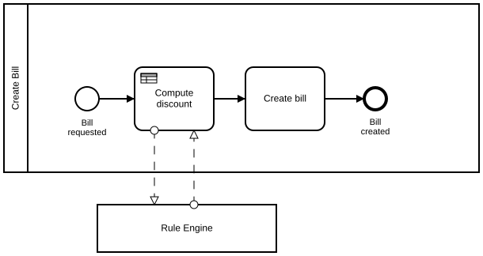
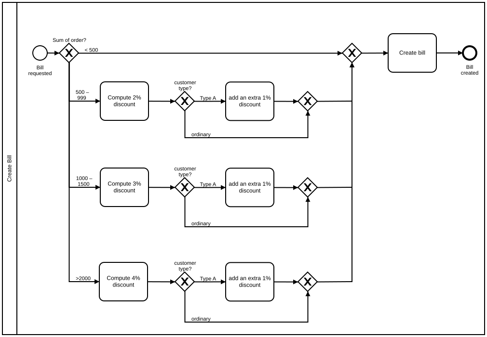

# Business Rules and BPMN

## Modeling Scenario

Let's say we want to model a process in BPMN and the process induces some business rules. We will use the example of creating a bill. In order to create the bill, a discount needs to be computed. The sum of the order and the customer type are the relevant criteria to compute the discount.

This is a very simple example which will show us where to apply BPMN and where not to.

## The Solution as BPMN 2.0 Diagram

**Camunda XML:** [../xml/image1.bpmn](../xml/image1.bpmn)

### Explanation

During modeling, we focus on the process flow. In this example, the process has two steps. A discount is computed before the bill is created. The result is a very simple process.

It does not make sense to model the calculation of the discount itself in the BPMN model (see the example below). For the rules decision tree, for every additional criteria, the cardinalities will grow exponentially. That is not what we want in a BPMN model.

Therefore, it makes sense to separate process and business rules.

## The Wrong Way to Model It

**Camunda XML:** [../xml/image2.bpmn](../xml/image2.bpmn)
