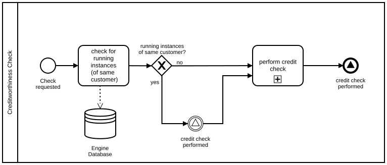
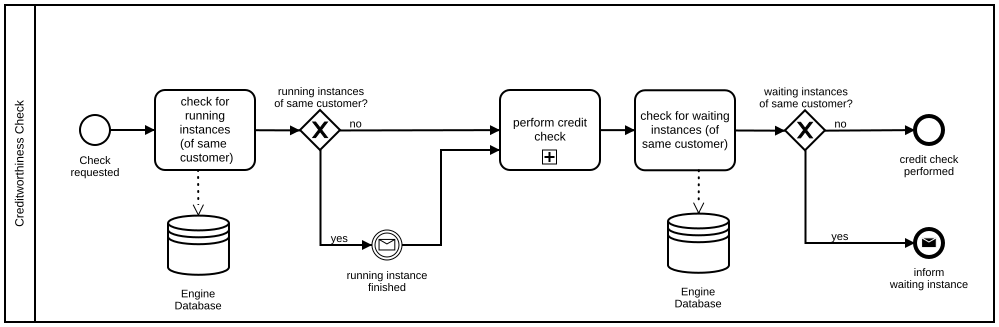
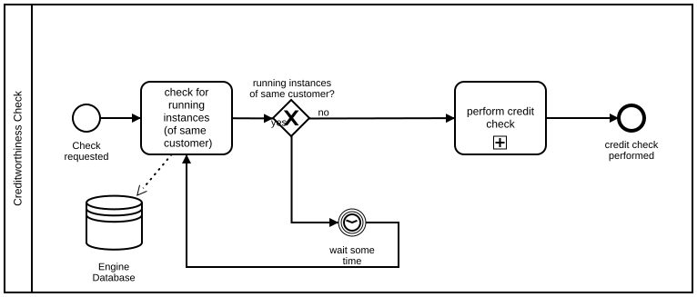

# Dependent Instances

## Modeling Scenario

Let's say we want to model a process with concurring instances. We are using a simple example. If one credit check of a customer is running, we do not want another credit check for the same customer to be performed at the same time.

The reason could be that the total number of credit checks performed influences the result of the check.

Let's assume that we are running a credit check for a customer and we get a second request for the same customer at the same time.

What all solutions have in common is that every new instance needs to check for concurring instances on the data level before starting the actual credit check.

## Solution with Signal Event

**Camunda XML:** [../xml/image3.bpmn](../xml/image3.bpmn)

The signal event is the easiest and most compact way to model the interaction between different instances. The problem of the signal is that it functions as a broadcast and does not address any specific instance. So, strictly speaking, the customer is ignored and all waiting instances catch it.

## Solution with Message Event

**Camunda XML:** [../xml/image4.bpmn](../xml/image4.bpmn)

This solution is a bit more complex, since you need to determine the recipient (a single instance) of the message. That induces a second data request before the end of the instance. However, this is the correct way to solve the problem that occurs in the signal event solution.

## Solution with Timer and Loop

**Camunda XML:** [../xml/image5.bpmn](../xml/image5.bpmn)

In this example we do not need any communication between instances. The instance itself checks periodicity if it can proceed to the credit check. The downside is that this might cause delays and overhead due to the loop.
