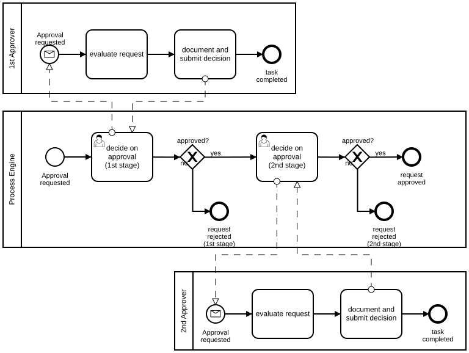
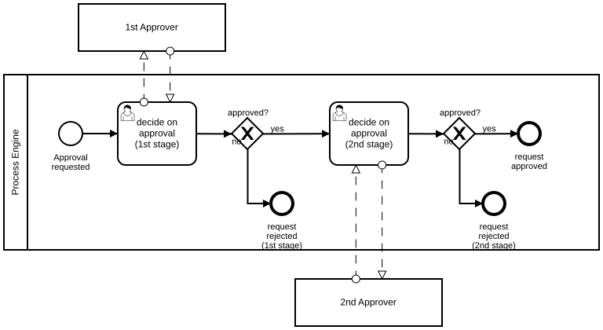
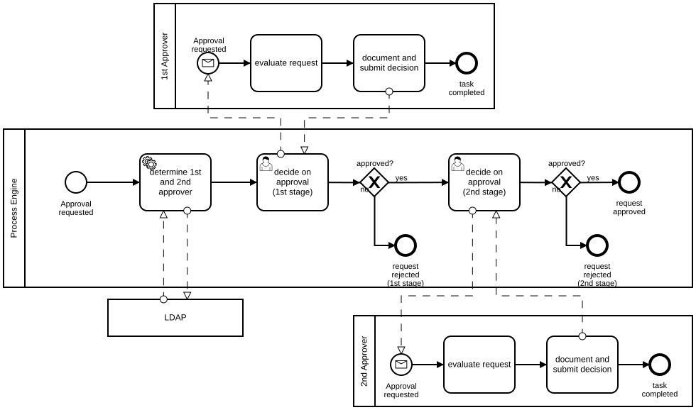

# Four Eyes Principle

## Modeling Scenario

We want to model the following situation using BPMN 2.0. For a request (e.g., a payment) two approvals of two different people are needed. A Process Engine should ensure that both approvals are fulfilled before the request is approved. The manual steps that are performed by the two approvers should also be modeled in the BPMN diagram. The approval decision is performed using a portal with a Tasklist.

## The Use Cases

The use cases for this pattern are numerous. Here are some examples:

- Payment Approval
- Invoice Approval
- Contract Approval
- …

## The Solution as BPMN 2.0 Diagram

**Camunda XML:** [../xml/image6.bpmn](../xml/image6.bpmn)

### Explanation

We use separate pools for the Process Engine, for the 1st Approver and for the 2nd Approver. This way, we can clearly define who is in control of which process.

In the engine pool, user tasks are used. These user tasks correspond to the tasks which are shown in the Tasklist of the 1st and the 2nd approver.

The interaction between the user tasks in the engine and between the manual process of the approvers is modeled using message flows. These message flows encapsulate the manual steps which the approver needs to perform in order to complete the user task.

The Tasklist itself is not modeled, in order to reduce complexity.

## Variations

### Approver as Collapsed Pools

**Camunda XML:** [../xml/image7.bpmn](../xml/image7.bpmn)

### Approver Determination with LDAP

**Camunda XML:** [../xml/image8.bpmn](../xml/image8.bpmn)
