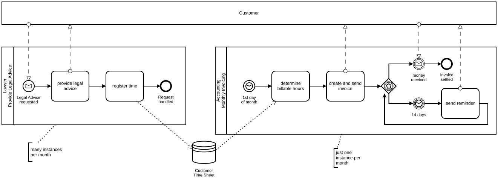
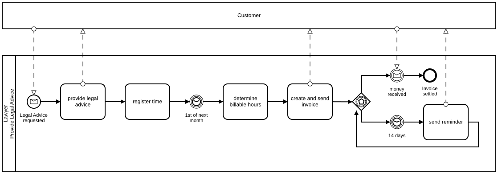

# Monthly Invoicing

## Modeling Scenario

This example explains a very common struggle with structuring BPMN 2.0 diagrams. Let's say there is a lawyer who offers legal advice to his customers. The service works as follows: The customers can ask for legal advice whenever they need it. The lawyer provides the requested advice and puts the billable hours on the customer's time sheet. When the month is over, the lawyer's accountant determines the billable hours based on the time sheet and creates the invoice.

This example illustrates a very common modeling scenario. It's not the steps of the processes that are difficult, it's the structure of the diagram.

## The Solution as BPMN 2.0 Diagram

**Camunda XML:** [../xml/image9.bpmn](../xml/image9.bpmn)

The most important aspect of the diagram is its structure.

The Provide Legal Advice process is performed many times per month. The Monthly Invoicing process is only performed once a month. Therefore, these two processes should be modeled as separate pools.

Of course these two pools are not completely independent from each other. Why? They work on the same data – the customer's time sheet. Our ability to model such a data-related connection is very limited in BPMN. This is due to the fact that BPMN is focused on control flow rather than on data flow.

However, we can use the data store element to model this connection on the data level.

## The Wrong Way to Model It

**Camunda XML:** [../xml/image10.bpmn](../xml/image10.bpmn)

In this example, both processes are mixed into one. This is – at best – a very implicit way to model it. It would mean that for every provided legal advice an invoice is sent once the month is over. This way of modeling is wrong in most cases.
