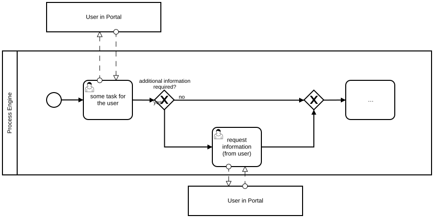
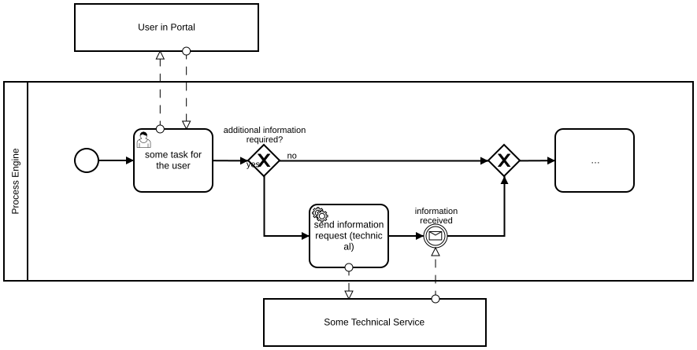

# Additional Information Required after User Task

## Modeling Scenario

Let's assume we want to model the following scenario: we want to execute a user task which is performed by a user in a portal. After the user task is completed, additional information might be required. If that is the case, the process engine sends an information request either to another user (solution 1) or to a technical service (solution 2).

## Solution 1: Request information from another User

**Camunda XML:** [../xml/image11.bpmn](../xml/image11.bpmn)

## Solution 2: Request information from a technical service

**Camunda XML:** [../xml/image12.bpmn](../xml/image12.bpmn)
