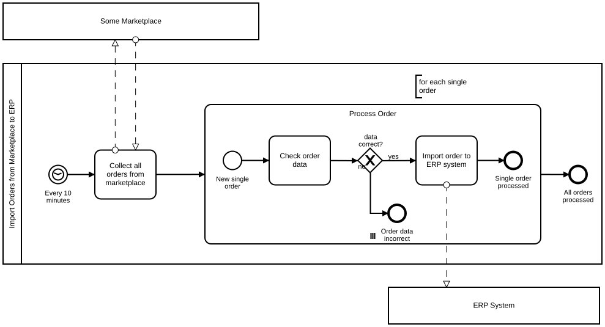

# Processing a Batch of Orders from a Marketplace

## The Situation

We want to model the following scenario using BPMN 2.0: let's assume a company receives orders from different distribution channels. One of these channels is a marketplace. Within certain intervals of time, the orders from the marketplace are fetched as a batch. Every order in this batch needs to be validated before being imported into the ERP System.

## The Solution as BPMN 2.0 Diagram

**Camunda XML:** [../xml/image13.bpmn](../xml/image13.bpmn)

This example shows a very common modeling scenario. We sometimes call it a 1-to-n problem. One process instance (Import of Orders) results in many single process instances of another process (ERP System). Typical constructs are multi instance or loops that start other processes using messages (message flows).
