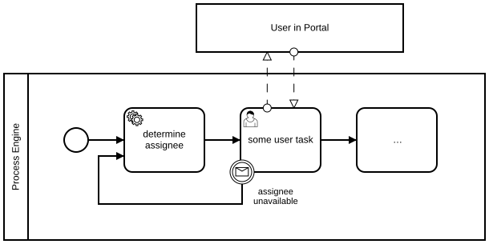
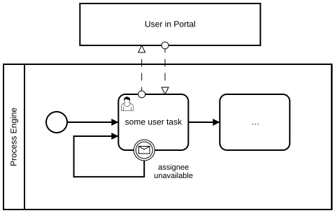

# Reassigning User Tasks

## Modeling Scenario

This example shows a very common modeling scenario. We sometimes call it a 1-to-n problem. One process instance (Import of Orders) results in many single process instances of another process (ERP System). Typical constructs are multi instance or loops that start other processes using messages (message flows).

## Solution 1: Message boundary event and reassignment service

**Camunda XML:** [../xml/image14.bpmn](../xml/image14.bpmn)

This makes sense if the engine calls a service to determine the new assignee.

## Solution 2: Message boundary event and reassignment rules

**Camunda XML:** [../xml/image15.bpmn](../xml/image15.bpmn)

This makes sense if the engine calls a rule engine to determine the new assignee.

## Solution 3: Message boundary event and implicit reassignment

**Camunda XML:** [../xml/image16.bpmn](../xml/image16.bpmn)

This makes sense if the engine determines the new assignee itself, e.g., by using an expression.
