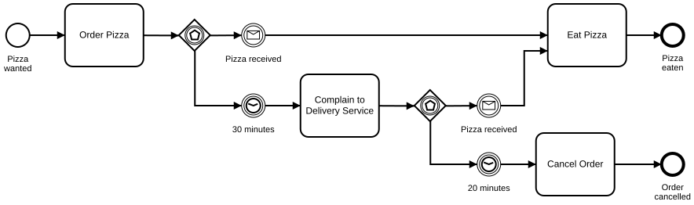
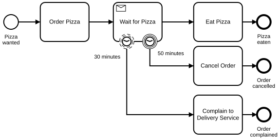
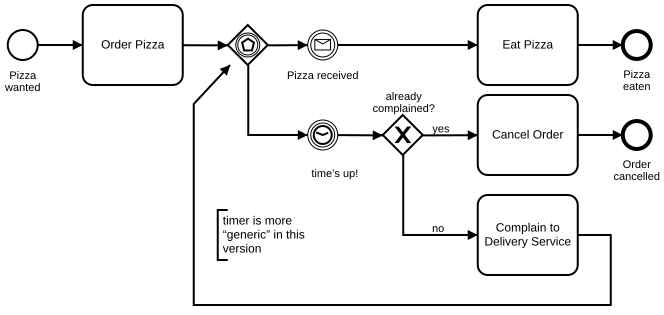

# Two Step Escalation

## Modeling Scenario

We will use the following example to illustrate how to model a two step escalation using BPMN 2.0. When we want a pizza, we order one. Sometimes the pizza delivery screws up and the delivery takes longer than 30 minutes. Then we complain to the delivery service. After that, we give them another 20 minutes to deliver the pizza. If they do not make it in time, we give up and cancel our order.

## Solution 1: Two Event-Based Gateways

**Camunda XML:** [../xml/image17.bpmn](../xml/image17.bpmn)

### Advantages of this solution

This solution very explicitly shows how the two step escalation is performed. Timers are modeled separately, followed by their corresponding escalation activities.

### Disadvantages of this solution

The event-based gateway is not an intuitive BPMN symbol of the BPMN standard, experience is required.

Using two event-based gateways makes the model larger and leads to a duplication of the “Pizza received” message event.

## Solution 2: Receive Task with timers attached

**Camunda XML:** [../xml/image18.bpmn](../xml/image18.bpmn)

### Advantages of this solution

This model is smaller than the first solution and probably the way most developers would solve the problem on the engine. Since we use a non-interrupting attached timer event, this solution is more flexible when it comes to multiple complaints (e.g., we want to complain every 5 minutes until 50 minutes are over).

### Disadvantages of this solution

The receive task is usually not intuitive for the “business guys”, who would rather use message receive events for that kind of wait state.

The way that the interrupting and non-interrupting timer collaborate requires profound understanding of attached events.

## Solution 3: One Event-Based Gateway with a generic timer

**Camunda XML:** [../xml/image19.bpmn](../xml/image19.bpmn)

### Advantages of this solution

This model is the compact and generic solution to the problem. If it comes to n-step escalation then you will need this generic approach to avoid huge diagrams.

### Disadvantages of this solution

The generic solution is less explicit than the other solutions. We do not see the actual duration of the timers, as a single timer is used for both durations.

For a fast understanding of the two step escalation, this method of modeling is not suitable.
