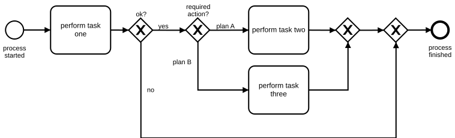
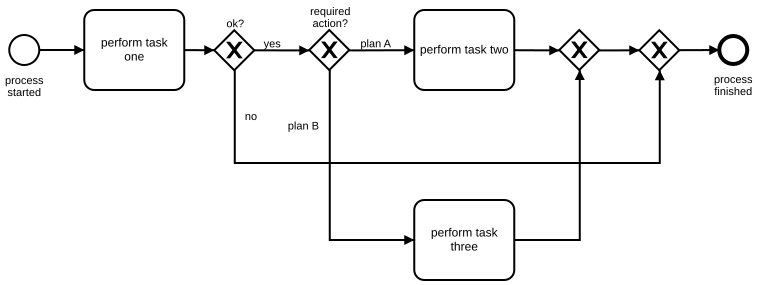

# Avoid Crossing Flows

## Recommendation

This BPMN example is about creating a good layout of process models. The better the layout, the higher the degree of understanding. That is what we want to achieve when we create process models.

Try to avoid crossing flows as much as possible. This will increase understanding of BPMN process models – for both experienced and inexperienced BPMN users.

Of course it is not always possible to entirely avoid this problem. Bear in mind that it always makes sense to invest some extra time in optimizing the layout in a way that most crossing flows are eliminated.

The examples below illustrate the problem with an abstract example.

## Good Example of Handling Flows

**Camunda XML:** [../xml/image20.bpmn](../xml/image20.bpmn)

## Counter-example

**Camunda XML:** [../xml/image21.bpmn](../xml/image21.bpmn)
