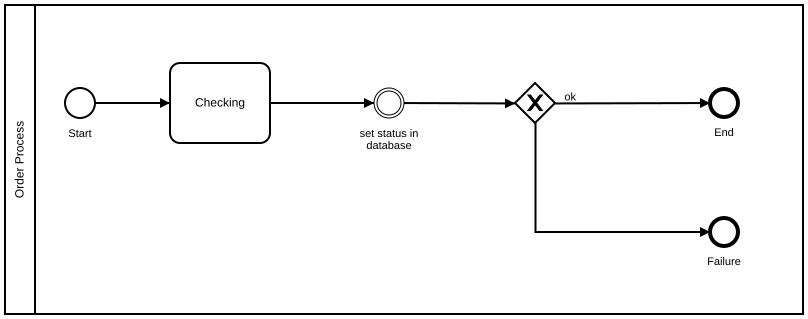

# Naming Conventions

## Recommendation

Most important: every BPMN symbol should have a label.

Events should be labeled using object + past participle. Start events should always be labeled with an indication of the trigger of the process. End events should be labeled with the end state of the process.

The process (pool) itself should also always be labeled. This label should indicate the name of the process and the role that is performing it.

Tasks should be labeled using object + verb. This forces the modeling person to focus on what is really done during the task.

X-OR Gateways should be labeled with a question. The outgoing sequence flows should be labeled with the possible answers to these questions (conditions).

## Good Example of Naming

**Camunda XML:** [../xml/image22.bpmn](../xml/image22.bpmn)

## The Generic Version

**Camunda XML:** [../xml/image23.bpmn](../xml/image23.bpmn)

## Counter Example

**Camunda XML:** [../xml/image24.bpmn](../xml/image24.bpmn)
