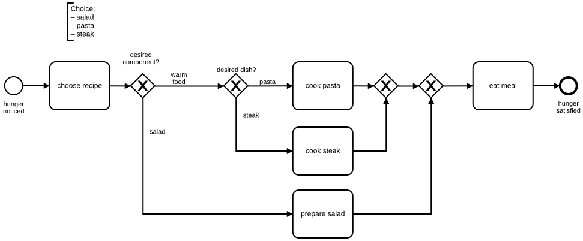
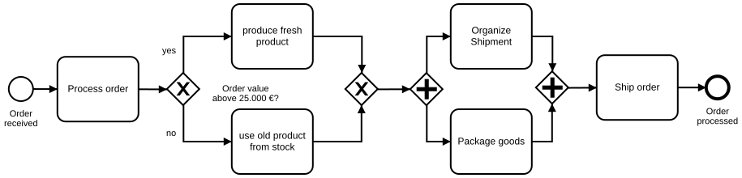
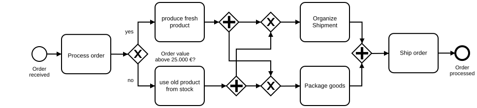

# Symmetric Modeling

## Recommendation

This BPMN example is about creating a good layout of process models. The better the layout, the higher the degree of understanding. That is what we want to achieve when we create process models.

We have determined that symmetric structures increase understanding of BPMN process models – for both experienced and inexperienced BPMN users.

## Good Example of a Symmetric Model

**Camunda XML:** [../xml/image25.bpmn](../xml/image25.bpmn)

## Counter-example

**Camunda XML:** [../xml/image26.bpmn](../xml/image26.bpmn)

## Good Example of a Symmetric Model 2

**Camunda XML:** [../xml/image27.bpmn](../xml/image27.bpmn)

## Counter-example 2

**Camunda XML:** [../xml/image28.bpmn](../xml/image28.bpmn)
