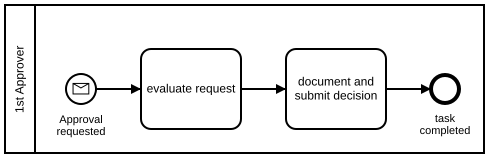

# Use Equal Task Sizes

## Recommendation

We recommend to always use equal task sizes.

The reason is simple. People tend to interpret task sizes although they do not have any semantics in the BPMN standard.

Some think that bigger tasks are more important than smaller tasks – according to BPMN that is wrong.

Some think that bigger tasks take more time than smaller tasks – according to BPMN that is wrong.

You can easily avoid that confusion by using equal task sizes.

## Good Example of Equal Task Sizes

**Camunda XML:** [../xml/image29.bpmn](../xml/image29.bpmn)

## Counter-example

**Camunda XML:** [../xml/image30.bpmn](../xml/image30.bpmn)
