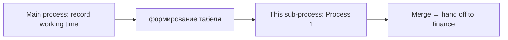

# Timesheet preparation (sub-process)

**Source:** `Диаграммы/табельныйучёт1.png`  
**Camunda XML:** `XML код/табельныйучёт1.bpmn`  
**Notation:** BPMN (Bizagi Modeler)  
**Diagram title:** Процесс 1 (Process 1)  
**Related to:** sub-process of task **«формирование табеля»** (timesheet generation) in the main process (`табельныйучёт2.md`)

---

## Simple explanation

The HR department checks three types of data at the same time: personnel orders, sick leave records, and timesheets. When all three reviews are complete, payroll statements are created — documents used for further calculations. The sub-process then ends and control returns to the main timekeeping process.

---

## Step-by-step flow

```
Sub-process "Process 1" starts
↓
Three checks run in parallel:
    ├─ Analysis of personnel orders     (manual)
    ├─ Analysis of sick leave           (manual)
    └─ Analysis of timesheets           (service / automated)
↓
Wait until all three branches finish
↓
Generate payroll statements
(output: document "ведомости" / statements)
↓
Sub-process complete
```

---

## Detailed description

### Purpose

The diagram details **internal HR work** to prepare the timesheet: collecting and reconciling data from different sources before producing final payroll statements.

### Structure

- A single horizontal **lane**: **Процесс 1** (Process 1).  
- Left-to-right flow with **parallel split and join**.  
- Watermark: *Powered by bizagi Modeler*.

### Elements and flow

**Start**  
- Green **start event** on the left side of the diagram.

**Parallel split**  
- Yellow diamond with a **"+"** — **parallel gateway (split)**.  
- The flow splits into **three concurrent branches**.

**Three parallel tasks**

| Branch | Diagram label | Type (icon) | Meaning |
|--------|---------------|-------------|---------|
| Top | **анализ приказов по персоналу** | Manual (hand) | Review personnel orders |
| Middle | **анализ больничных** | Manual (hand) | Review sick leave records |
| Bottom | **анализ табелей** | Service (gear) | Review / process timesheets |

**Parallel join**  
- Second diamond with **"+"** — **parallel gateway (join)**.  
- The next step runs only after **all three** branches complete.

**Task: формирование ведомостей** (generate statements)  
- **User task** (person icon).  
- **Output data object:** document **ведомости** (payroll statements), linked with a dotted line.

**End**  
- Red **end event** on the right.

### Process logic

1. Start → **three analyses run in parallel** (orders, sick leave, timesheets).  
2. When all three finish → **generate payroll statements**.  
3. Artifact **«ведомости»** is produced → sub-process **ends**.

### Place in the overall process



On the main timekeeping diagram (`табельныйучёт2.png`), this flow is nested inside task **«формирование табеля»** in the **кадровая служба** (HR) lane.
